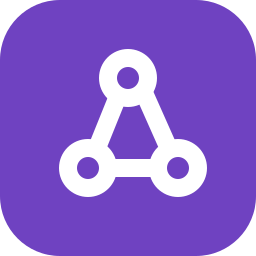

  <picture>
    <source media="(prefers-color-scheme: dark)" srcset="./assets/hero-dark.svg?v=synapse-motion-4">
    <source media="(prefers-color-scheme: light)" srcset="./assets/hero-light.svg?v=synapse-motion-4">
    
  </picture>

  
  &nbsp;&nbsp;
  
  &nbsp;&nbsp;
  

---

### About & Positioning

I operate within **Public Administration**, focusing on operational capability and process transformation through automation, data engineering, and agentic artificial intelligence. With a foundational background in **Law**, I approach administrative workflows through structural rules, regulatory constraints, and process mechanics—translating statutory requirements and real operational demands into automated digital solutions.

My technical focus spans:
- **Applied AI & Agentic Systems**: Designing deterministic workflows and collaborating with autonomous coding agents (Codex, Google Antigravity, Orca ADE, Hermes) for continuous software delivery.
- **Workflow Automation & Systems Integration**: Constructing event-driven pipelines, RESTful integrations, and webhook orchestration that remove operational bottlenecks.
- **Data Engineering & Reliability**: Developing reproducible data pipelines, verified contribution analytics, and resilient self-hosted platforms.

---

### Core Technical Stack

#### Automation, Agents & Integration

  
  
  
  
  
  
  

#### Development & Systems

  
  
  
  
  
  
  
  

#### Data & Infrastructure

  
  
  
  

---

### Featured Work & Autonomous Implementations

#### 🐜 Langton's Ant × Real GitHub Contributions
An original 2D cellular automaton implementation where the real contribution calendar initializes the automaton's binary state on an infinite virtual plane. Rather than a purely cosmetic overlay, the ant executes authentic RL rules (turn 90° right on 0, 90° left on 1, flip state, advance) rendered via declarative SMIL SVG animations.

  <picture>
    <source media="(prefers-color-scheme: dark)" srcset="https://raw.githubusercontent.com/leozaow/leozaow/output/langton-contribution-graph-dark.svg">
    <source media="(prefers-color-scheme: light)" srcset="https://raw.githubusercontent.com/leozaow/leozaow/output/langton-contribution-graph.svg">
    
  </picture>

  
🔍 Technical Details & Architecture

  <ul>
    <li><b>Automaton Dynamics</b>: Classical binary Langton's Ant simulated on an unbounded 2D coordinate plane without toroid edge wrapping.</li>
    <li><b>Seed Condition</b>: Evaluates <code>contributionCount &gt; 0 &rarr; state 1</code>; cell intensity preserves GitHub quartile shades.</li>
    <li><b>Deterministic Horizon Discovery</b>: Simulates 10,000 steps deterministically to select optimal starting vectors.</li>
    <li><b>Documentation</b>: See <a href="LANGTON_ANT_SPEC.md">LANGTON_ANT_SPEC.md</a>.</li>
  </ul>

 

#### 📊 Self-Hosted GitHub Contribution & Streak Analytics
A mathematically rigorous contribution and streak calculation engine built in Python 3.12 without external dependencies. Features current-day grace rules, canonical UTC/São Paulo timezone reconciliation, genuine date-membership chart highlighting, and static accessibility fallbacks.

  <picture>
    <source media="(prefers-color-scheme: dark)" srcset="https://raw.githubusercontent.com/leozaow/leozaow/output/streak.dark.svg">
    <source media="(prefers-color-scheme: light)" srcset="https://raw.githubusercontent.com/leozaow/leozaow/output/streak.light.svg">
    
  </picture>

  
🔍 Methodology & Diagnostics

  <ul>
    <li><b>Mathematical Integrity</b>: Accurate daily streaks accounting for unfinished current calendar days without interval inversion.</li>
    <li><b>Recent Activity Series</b>: 35-day discrete daily volume with exact date-membership highlighting.</li>
    <li><b>Full Provenance</b>: Machine-readable telemetry published daily to <code>stats.json</code> on the <code>output</code> branch.</li>
    <li><b>Documentation</b>: See <a href="docs/METRICS_METHODOLOGY.md">METRICS_METHODOLOGY.md</a> and <a href="docs/ARCHITECTURE.md">ARCHITECTURE.md</a>.</li>
  </ul>

---

### Repository Architecture & Documentation

- [System Architecture](docs/ARCHITECTURE.md) — Subsystem decomposition, branch strategy, and data flow.
- [Metrics Methodology](docs/METRICS_METHODOLOGY.md) — Mathematical definitions, temporal semantics, and streak formulas.
- [Operations Guide](docs/OPERATIONS.md) — Routine workflows, manual triggers, rollback, and asset publishing.
- [Testing & QA Matrix](docs/TESTING.md) — 62 automated unit tests, edge-case scenarios, and property verification.
- [Visual Identity](VISUAL_IDENTITY.md) — Design tokens, color system, typography, and motion accessibility.
- [Agent Guidelines](AGENTS.md) — Governance rules for autonomous AI development agents.
