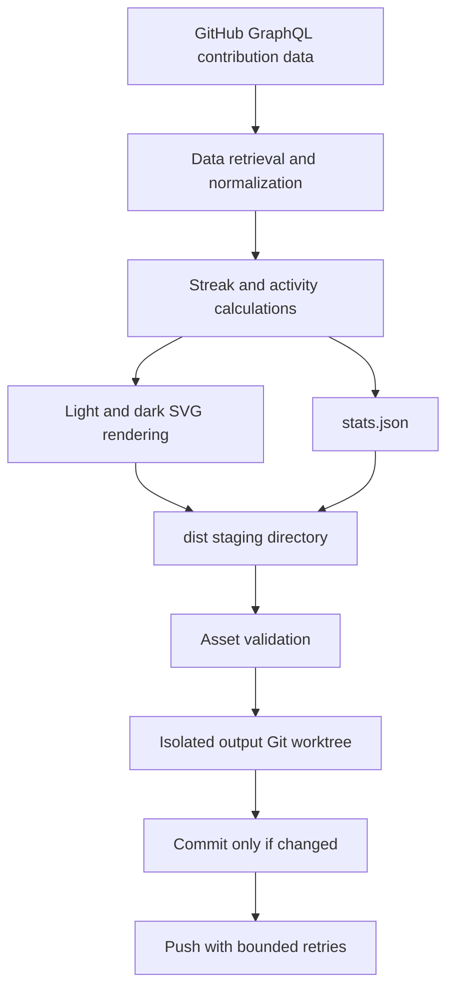

# Repository Architecture

## 1. Purpose

`leozaow/leozaow` hosts the author's personal GitHub profile and a lightweight, self-updating GitHub contribution analytics card. The public README describes personal technology experimentation; it is **not** a professional software engineering résumé or documentation for an institutional system.

The repository favors accurate metrics, few dependencies, and reproducible SVG generation.

## 2. Branches and Assets

| Branch | Responsibility |
|---|---|
| `main` | Profile READMEs, unchanged hero assets, icon definitions, generators, tests, workflows, and documentation |
| `output` | Published generated files: `streak.light.svg`, `streak.dark.svg`, and `stats.json` |

The `output` branch may retain older assets for historical reference. They are not part of the active generation pipeline. Generated daily data should not add commits to `main`.

## 3. Active Components

```text
.github/workflows/
  profile-assets.yml          # Scheduled generation and publication
  validation.yml              # PR/push validation
assets/
  hero-light.svg              # Existing hero, light
  hero-dark.svg               # Existing hero, dark
  badges/                     # Curated tool icons
scripts/
  generate_streak.py          # CLI and generation entry point
  validate_assets.py          # SVG/JSON structure and safety checks
  stats/
    github.py                 # GitHub GraphQL retrieval
    models.py                 # Canonical data structures
    calculations.py           # Deterministic contribution calculations
    renderer.py               # Light/dark SVG rendering
tests/
  test_stats.py               # Temporal and data integrity cases
  test_stats_renderer.py      # SVG rendering tests
docs/
  ARCHITECTURE.md
  METRICS_METHODOLOGY.md
  OPERATIONS.md
  TESTING.md
README.md                     # Main, English-language GitHub profile
README.pt-BR.md               # Portuguese-language companion
VISUAL_IDENTITY.md
AGENTS.md
```

## 4. Generation and Publication



The publication workflow runs the test suite before generation, validates the required assets, and pushes to `output`. It must fail if publication cannot be completed. The publication branch must not be force-pushed.

## 5. Data Integrity and Safety

- GitHub **contributions** are not interchangeable with Git **commits**.
- Reference dates, rolling windows, UTC-based contribution calendar semantics, and grace periods are specified in [Metrics Methodology](METRICS_METHODOLOGY.md).
- Query failures or missing days must not be represented as legitimate zero-contribution days.
- Credentials are supplied via GitHub Actions environment secrets and must not enter generated assets.
- SVGs have no JavaScript and need valid XML with readable static content.
- Existing hero images remain unchanged by routine analytics maintenance.

See [Operations](OPERATIONS.md) for manual generation and rollback, and [Testing](TESTING.md) for verification commands.
