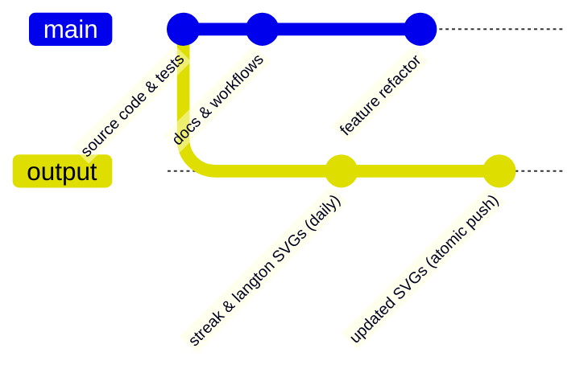
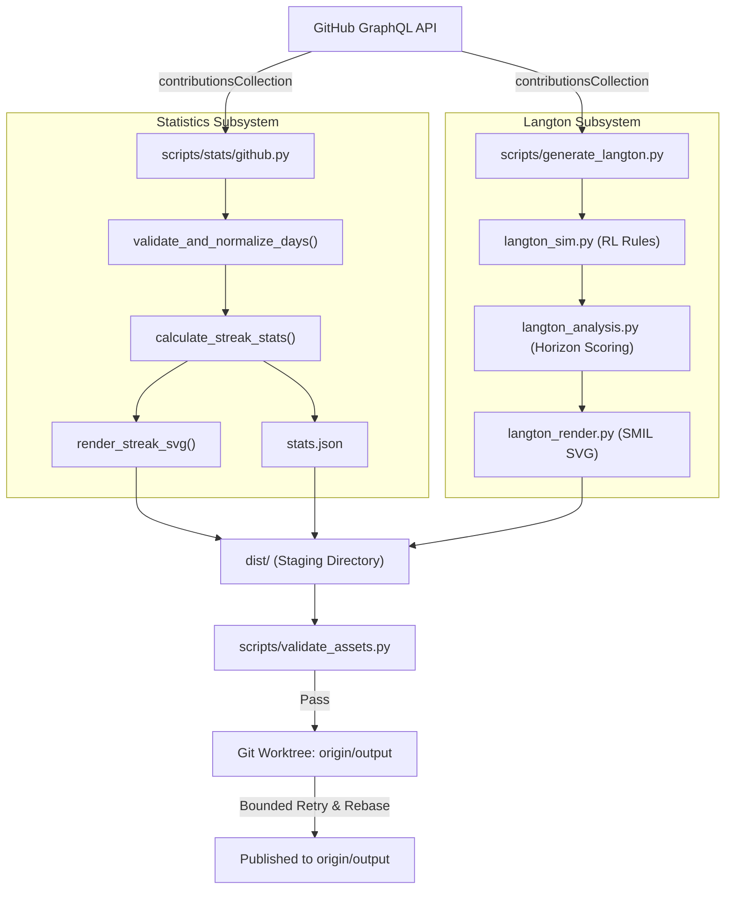

# System Architecture

## 1. Overview & Architectural Goals

The `leozaow/leozaow` repository serves as both the personal GitHub Profile README for **Leandro Barbosa** and an autonomous, self-hosting engineering platform. The system is engineered around four non-negotiable architectural tenets:

1. **Mathematical Accuracy**: No fabricated statistics, no artificial contribution farming, and no conflation between commits and contributions.
2. **Branch Separation & Clean Provenance**: Code, tests, and human documentation live on `main`. Daily automated artifacts live exclusively on the `output` branch.
3. **Idempotent, Safe Automation**: Workflows fail honestly on network or push errors, avoiding silent success masking.
4. **Deterministic Graphics**: Standalone SVGs without client-side JavaScript, external font dependencies, or unrecoverable animation degradation.

---

## 2. Branch Topology & Storage Model



### Branch Responsibilities
- **`main`**: The primary version-controlled branch. Holds application source code (`scripts/`), unit test suites (`tests/`), GitHub Actions workflows (`.github/workflows/`), documentation (`docs/`), static assets (`assets/hero-*.svg`, `assets/badges/`), and profile READMEs (`README.md`, `README.pt-BR.md`). Commit history is curated using Conventional Commits.
- **`output`**: An asset delivery branch. Receives automated daily commits containing generated SVG visualizations (`streak.light.svg`, `streak.dark.svg`, `langton-contribution-graph.svg`, `langton-contribution-graph-dark.svg`) and machine-readable telemetry (`stats.json`). Preserves historical rollback artifacts (such as Pac-Man contribution SVGs).

---

## 3. Subsystem Decomposition

The repository is structured into distinct, decoupled subsystems:

```
leozaow/
├── .github/
│   └── workflows/
│       ├── profile-assets.yml     # Daily scheduled generation & output branch publisher
│       └── validation.yml         # CI suite triggered on pushes and PRs
├── assets/
│   ├── badges/                    # Custom SVGs for developer tooling & infrastructure
│   ├── hero-dark.svg              # Standalone synaptic network hero (dark mode)
│   └── hero-light.svg             # Standalone synaptic network hero (light mode)
├── docs/
│   ├── ARCHITECTURE.md            # System architecture and data flow
│   ├── METRICS_METHODOLOGY.md     # Mathematical streak & contribution definitions
│   ├── OPERATIONS.md              # Operational procedures, troubleshooting, and rollback
│   └── TESTING.md                 # Test harness, property verification, and QA
├── scripts/
│   ├── stats/
│   │   ├── __init__.py            # Public package interface
│   │   ├── calculations.py        # Pure mathematical functions for streaks and windows
│   │   ├── github.py              # GraphQL client with date chunking and retry handlers
│   │   ├── models.py              # Canonical dataclasses and JSON serialization
│   │   └── renderer.py            # Responsive, accessible SVG visual card renderer
│   ├── generate_streak.py         # CLI driver for streak generation
│   ├── generate_langton.py        # CLI driver for Langton's Ant simulation
│   ├── langton_sim.py             # Classical RL 2D automaton simulation engine
│   ├── langton_analysis.py        # Multi-thousand step horizon analysis & scoring
│   ├── langton_render.py          # Native SMIL SVG renderer for Langton's Ant
│   └── validate_assets.py         # Strict XML, schema, and security validator
└── tests/
    ├── fixtures/                  # Deterministic contribution calendars
    ├── test_langton.py            # Langton simulation and SVG tests
    ├── test_stats.py              # 35 streak and data-integrity edge cases
    └── test_stats_renderer.py     # SVG accessibility and theme verification
```

---

## 4. End-to-End Pipeline & Data Flow



---

## 5. Security & Isolation Controls

1. **Least-Privilege Workflows**:
   - `validation.yml` runs with `permissions: contents: read`.
   - `profile-assets.yml` runs with `permissions: contents: write` restricted to updating the `output` branch.
2. **Token Sanitization**:
   - Access tokens are read strictly from process environment variables (`GITHUB_TOKEN`).
   - `validate_assets.py` scans every generated SVG and JSON file to ensure no tokens or sensitive strings (`ghp_`, `gho_`, `Bearer`) are embedded.
3. **No Dynamic Execution**:
   - SVGs contain zero JavaScript (`<script>` elements are strictly prohibited and enforced by unit tests).
